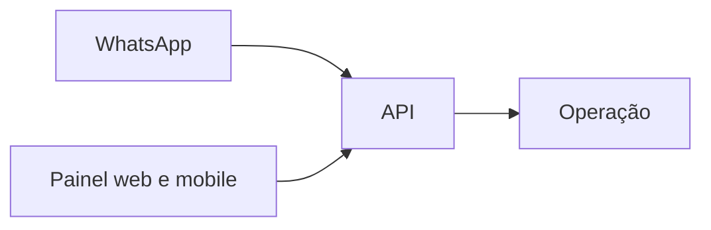

# Wagoo

Estudo de caso público. O código do produto é proprietário e não está neste repositório.

SaaS para espaços de atendimento, no ar em [wagoobot.com](https://wagoobot.com/). A agenda entra pelo WhatsApp, com sinal e comissões, e a operação acompanha tudo num painel. A rotina que antes ficava em conversa manual passa a ser um fluxo do produto.

No mesmo ecossistema existe o Shopwag, a loja com link próprio do negócio: vitrine, checkout e pedidos no painel.

## O que eu fiz

Trabalhei na plataforma em produção, cobrindo automação do atendimento e o painel da operação.

- Agendamento e atendimento pelo WhatsApp
- Sinal, comissões e split de pagamento no mesmo fluxo
- Painel web e mobile para a operação
- Aplicação publicada com React, Node.js, AWS e Docker

## Arquitetura



| Parte | Responsabilidade |
| --- | --- |
| WhatsApp | Entrada do agendamento e do atendimento |
| API | Agenda, sinal, comissões e regras da operação |
| Painel | Acompanhamento em tempo real, web e mobile |
| Infra | Publicação com AWS e Docker |

## Stack

React, Node.js, AWS, Docker.

## Recorte de código

`src/` é um exemplo da regra de agenda, escrito para este portfólio. Não é o serviço em produção: não há WhatsApp, pagamento, painel nem dados reais.

A função `hasConflict` impede dois horários do mesmo profissional no mesmo intervalo e permite que o próximo comece exatamente quando o anterior termina.

```bash
npm install
npm test
```
